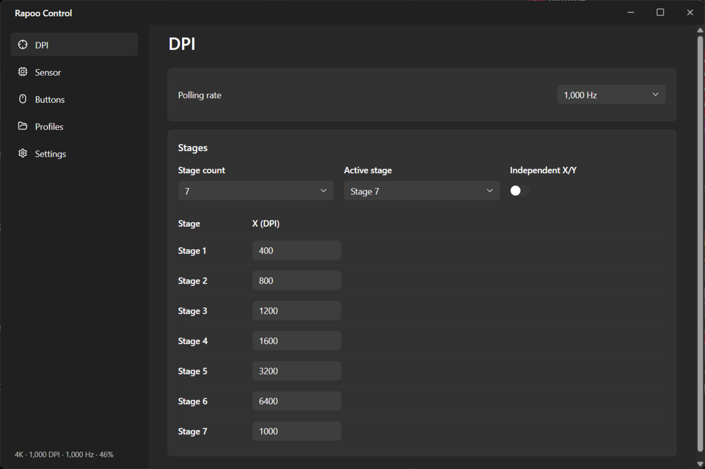
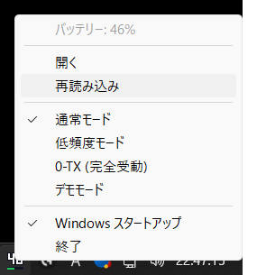

# Rapoo VT9 Pro 4K

Windows tools and a HID protocol implementation for the Rapoo VT9 Pro 4K.

## Download

[Releases](https://github.com/nico2525nn/rapoo-vt9pro-4k/releases)

- `rapoo-control-winui-v1.3.0-windows-amd64.exe` — native WinUI 3 app (Windows, single file)
- `rapoo-control-v1.3.0-windows-amd64.exe` — Wails app (Windows)
- `rapoo-control-v1.3.0-linux-amd64` — Wails app (Linux)
- `vt9tray-v1.3.0-windows-amd64.exe` — battery tray app
- `vt9ctl-v1.3.0-windows-amd64.exe` / `vt9ctl-v1.3.0-linux-amd64` — CLI
- `checksums.txt` — SHA256 checksums

## Screenshots

| Native WinUI 3 | Wails |
|:---:|:---:|
|  |  |
| WinUI 3 overview (Japanese) | Wails DPI / polling page (English) |

| Battery icon | Notification-area menu |
|:---:|:---:|
|  |  |
| Transparent 7-segment icon with a level bar | Right-click modes, startup, and quit |

## Usage

- `vt9tray.exe`: run it. Right-click for polling mode and exit.
- `rapoo-control.exe`: configure DPI, sensor, buttons, profiles, and app settings from the sidebar.
- `vt9ctl.exe`: `list`, `battery`, `info`, `watch`.

Features: DPI, polling rate, lift-off distance, Motion Sync, debounce, 10 buttons, profiles, 0-TX (gaming lock), and demo mode.

### WinUI 3 app

Run `rapoo-control-winui-v1.3.0-windows-amd64.exe`. It is a single file; the Go HID sidecar is embedded and extracted to `%LOCALAPPDATA%\rapoo-vt9pro-4k\bin` on first launch.

- All pages read and write the device: DPI, sensor, 10 buttons, profiles, settings.
- Firmware update is read-only in this app. It launches the official Rapoo software and never flashes firmware itself.
- Use the icon-only Reload and Apply buttons at the bottom-right of the sidebar to apply staged changes.
- The notification area shows the live battery percentage as a transparent 7-segment icon with a level bar. Right-click for modes, demo, startup, and quit.
- Closing the window exits by default. Enable close-to-tray in Settings to keep it in the notification area; old close-to-tray preferences are migrated to off so a hidden window can always be recovered.
- Enable "Start in the notification area" alongside Windows startup to launch into the tray. WinUI and Wails use separate Run entries, so enabling one does not overwrite the other. v1.2.0 auto-start entries migrate when the new app starts; if you renamed the executable, enable auto-start once again.
- The Wails app and the WinUI app can both be installed, but only one can own the HID command handle at a time.
- Only one process can own the HID handle. Do not run the WinUI app and the Wails app/tray at the same time.

## Language

English is the default. Change the language in Settings → Language: **English** or **日本語**.

To set the initial language before the first launch:

```bat
setx RAPOO_LANG en
setx RAPOO_LANG ja
```

`RAPOO_LANG` is the default for a fresh profile. A language selected in Settings is saved and takes precedence on later launches. The value is also passed to the WinUI sidecar.

## UI

- Linux / Windows Wails UI: React 19 + Tailwind CSS v4 + current shadcn/ui
- Windows native: `winui/RapooControl` (WinUI 3 / Windows App SDK, real device access via the Go sidecar)

Both UIs use the WinUI 3 color tokens for surfaces, cards, text, and accent states.

## Build

```bash
go test ./...

# Windows tray / CLI
GOOS=windows GOARCH=amd64 go build -trimpath -ldflags="-H=windowsgui -s -w" -o dist/vt9tray.exe ./cmd/vt9tray
GOOS=windows GOARCH=amd64 go build -trimpath -ldflags="-s -w" -o dist/vt9ctl.exe ./cmd/vt9ctl
GOOS=linux GOARCH=amd64 go build -trimpath -ldflags="-s -w" -o dist/vt9ctl ./cmd/vt9ctl

# WinUI sidecar
GOOS=windows GOARCH=amd64 go build -trimpath -ldflags="-s -w" -o build/bin/rapoo-bridge.exe ./cmd/rapoo-bridge

# Wails app
go install github.com/wailsapp/wails/v2/cmd/wails@v2.17.1
wails build -platform windows/amd64
wails build -platform linux/amd64 -tags webkit2_41

# Frontend
cd frontend && npm ci && npm test && npm run build

# WinUI 3 (Windows + .NET 9 SDK)
dotnet build winui/RapooControl/RapooControl.csproj -c Release -p:Platform=x64

# Single-file WinUI release (embeds the sidecar)
dotnet publish winui/RapooControl/RapooControl.csproj -c Release -p:Platform=x64 -p:PublishSingleFile=true -p:RapooBridgePath=C:\path\to\rapoo-bridge.exe -o dist/winui
```

## Troubleshooting

- Not detected: check the 4K receiver or the USB-C cable.
- Cannot change settings: disable 0-TX (gaming lock).
- Linux permission error: install the hidraw udev rule.

  ```udev
  SUBSYSTEM=="hidraw", ATTRS{idVendor}=="24ae", MODE="0660", TAG+="uaccess"
  ```

- Firmware update: this project never flashes firmware. Use the official Rapoo software.

## Protocol

[docs/PROTOCOL.md](docs/PROTOCOL.md)

## License

MIT
