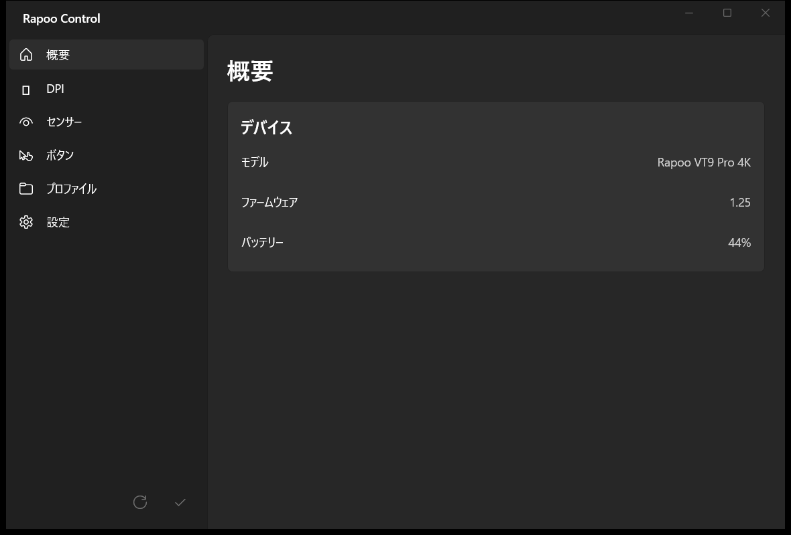
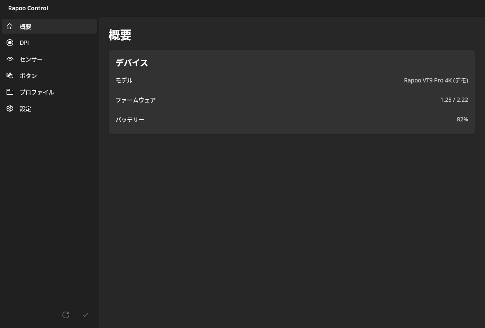
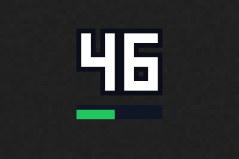

# Rapoo VT9 Pro 4K

A cross-platform Rapoo VT9 Pro 4K controller for Windows and Linux, built with
Uno Platform and WinUI. The UI is the existing WinUI layout; the Go sidecar
remains the only process that touches HID.

## Download

[Releases](https://github.com/nico2525nn/rapoo-vt9pro-4k/releases)

Each platform has two bundles. **portable** is self-contained and the best
choice for a fresh machine. **slim** is the smallest app download and needs the
runtimes listed below. The Windows slim `.7z` is about one twelfth of the
v1.4.0 Windows download, and the Linux slim `.tar.xz` is about one third of the
v1.4.0 Linux tarball.

| Bundle | Download | Requires |
|:--|:--|:--|
| Windows slim | `rapoo-control-uno-v1.5.1-windows-amd64-slim.7z` (8.9 MB) / `.zip` (14.1 MB) | .NET 10 Desktop Runtime, Windows App Runtime 2.x (2.5.1 or later, x64) |
| Windows portable | `...-windows-amd64-portable.7z` (47.8 MB) / `.zip` (76.4 MB) | nothing |
| Linux slim | `...-linux-amd64-slim.tar.xz` (15.6 MB) / `.tar.gz` (22.1 MB) | .NET 10 Runtime |
| Linux portable | `...-linux-amd64-portable.tar.xz` (21.2 MB) / `.tar.gz` (30.6 MB) | nothing (X11 + OpenGL) |

- A `.7z` needs [7-Zip](https://www.7-zip.org/); the `.zip` opens with Windows
  Explorer. On Linux, `tar.xz` is smaller and `tar.gz` is more widely supported.
- `.NET 10 Desktop Runtime`:
  <https://dotnet.microsoft.com/download/dotnet/10.0>
- `Windows App Runtime 2.x` (x64, 2.5.1 or later):
  <https://aka.ms/windowsappsdk/2.5/2.5.1/windowsappruntimeinstall-x64.exe>
  The app uses the Windows App SDK 2.x runtime with a 2.5.1 minimum. The
  2.5.1 installer linked above is the smallest known-good runtime; newer 2.x
  runtimes also work. The installer is about 120 MB.
- `checksums.txt` — SHA256 checksums for every asset.

The v1.4.0 self-contained release remains available for reference. The v1.3.0
WinUI/Wails releases are unchanged.

## Screenshots

| Windows | Linux |
|:---:|:---:|
|  |  |
| Overview (Japanese) | Overview (Japanese) |

| Battery icon | Notification-area menu |
|:---:|:---:|
|  |  |
| Transparent 7-segment icon with a level bar | Right-click modes, startup, and quit |

## Usage

### Windows

- **Portable (recommended for a fresh machine):** extract the archive and run
  `RapooControl.exe`. No runtime installation is needed.
- **Slim:** install the [.NET 10 Desktop
  Runtime](https://dotnet.microsoft.com/download/dotnet/10.0) and the [Windows
  App Runtime 2.x (x64, 2.5.1 or
  later)](https://aka.ms/windowsappsdk/2.5/2.5.1/windowsappruntimeinstall-x64.exe),
  then extract the archive and run `RapooControl.exe`. The 2.5.1 installer is
  the smallest known-good runtime; newer 2.x runtimes also work.

The Go sidecar is included next to the app.

- DPI, polling rate, lift-off distance, Motion Sync, debounce, 10 buttons,
  profiles, 0-TX (gaming lock), and demo mode.
- The notification area shows the live battery percentage. Right-click for
  modes, demo, startup, and quit.
- Closing the window exits by default. Enable close-to-tray in Settings to
  keep it running in the notification area.
- "Start in the notification area" launches hidden when Windows signs in.
- The old WinUI and Wails apps use separate startup entries and instance
  locks. Exit them before running this release; only one process can own the
  HID command handle.

### Linux

- **Portable (recommended for a fresh machine):** extract the archive and run
  `./RapooControl`. The bundle is self-contained and only needs X11, OpenGL,
  and fontconfig from the system.
- **Slim:** install the [.NET 10
  Runtime](https://dotnet.microsoft.com/download/dotnet/10.0), extract the
  archive, and run `./RapooControl`. If the runtime is not in
  `/usr/share/dotnet`, point the app at it:

  ```bash
  DOTNET_ROOT="$HOME/.dotnet" ./RapooControl
  ```

- The app uses XDG autostart when enabled in Settings.
- A Linux tray is not implemented yet; close-to-tray and start-hidden are
  Windows-only.
- For `/dev/hidraw` access, apply the udev rule shown in Settings (also below):

  ```udev
  SUBSYSTEM=="hidraw", ATTRS{idVendor}=="24ae", MODE="0660", TAG+="uaccess"
  ```

## Language

The app follows the system language on a fresh profile; Japanese and English
are available in Settings. To seed the first launch:

```bash
RAPOO_LANG=ja ./RapooControl
```

The selected language is saved and takes precedence later. `RAPOO_LANG` is
also passed to the sidecar.

## UI

- Windows: Uno Platform / WinAppSDK head, using the existing WinUI layout.
- Linux: Uno Platform / Skia desktop head, same pages and controls.
- The Go sidecar lives in `cmd/rapoo-bridge` and is shared by both heads.
- `winui/` and the Wails frontend are legacy reference implementations.

## Build

```bash
# Go backend and both sidecars
go test ./...
./uno/build-sidecars.sh

# Windows / Linux heads
export PATH="$HOME/.dotnet:$PATH"
export DOTNET_ROOT="$HOME/.dotnet"
dotnet build uno/RapooControl/RapooControl.csproj -f net10.0-desktop -c Debug
dotnet build uno/RapooControl/RapooControl.csproj -f net10.0-windows10.0.26100 -c Debug

# Tests (DPI, bridge faults/restart, state ordering, autostart, migration)
dotnet test uno/RapooControl.Tests/RapooControl.Tests.csproj

# Linux release bundles (slim + portable, tar.xz + tar.gz)
./uno/package-linux.sh

# Windows release bundles (run on Windows after build-sidecars.sh;
# pass the release commit from the Linux checkout)
powershell -ExecutionPolicy Bypass -File uno/package-windows.ps1 -ExpectedSidecarRevision <sha>
```

The Linux smoke check runs a published bundle under Xvfb:

```bash
./uno/smoke-linux.sh dist/linux-portable/RapooControl
```

The Linux portable bundle is published with `PublishTrimmed=true`. The bridge
protocol uses source-generated `System.Text.Json` metadata, so trimming is safe
for the Skia head; the WinUI head is published untrimmed. The Windows publish
profiles also remove the unused Windows ML stack (ONNX Runtime and DirectML),
ReadyToRun images, and PDBs.

## Troubleshooting

- Not detected: check the 4K receiver or the USB-C cable.
- Cannot change settings: disable 0-TX (gaming lock).
- Linux permission error: apply the udev rule above, then reconnect the device.
- Firmware update: the app launches the official Rapoo software you select and
  never downloads or flashes firmware. A signed updater must carry a Rapoo
  certificate; an unsigned file requires an explicit confirmation. The sidecar
  also checks the absolute path and file name.

## Protocol

[docs/PROTOCOL.md](docs/PROTOCOL.md)

## License

MIT
